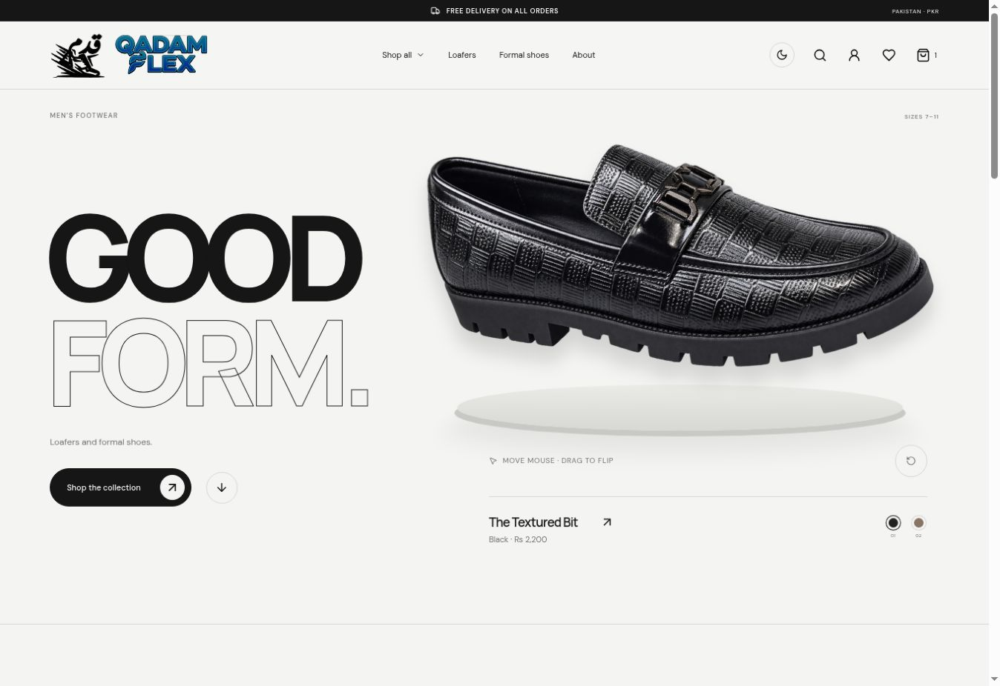
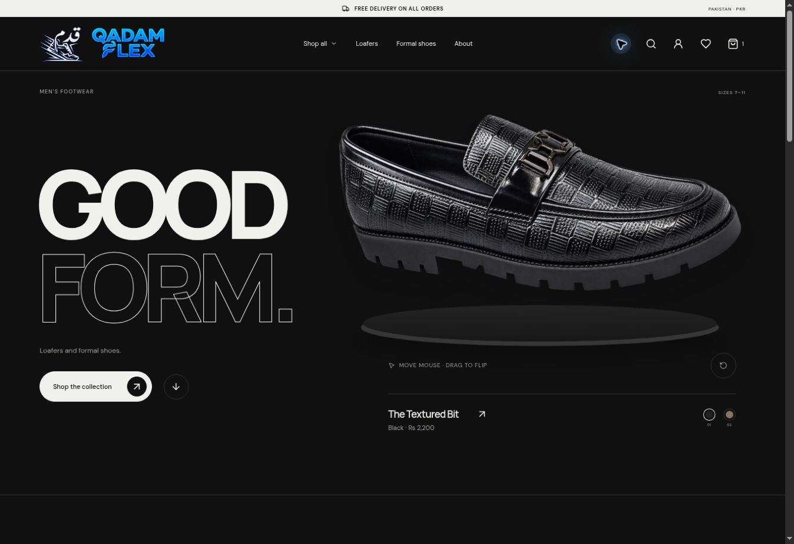
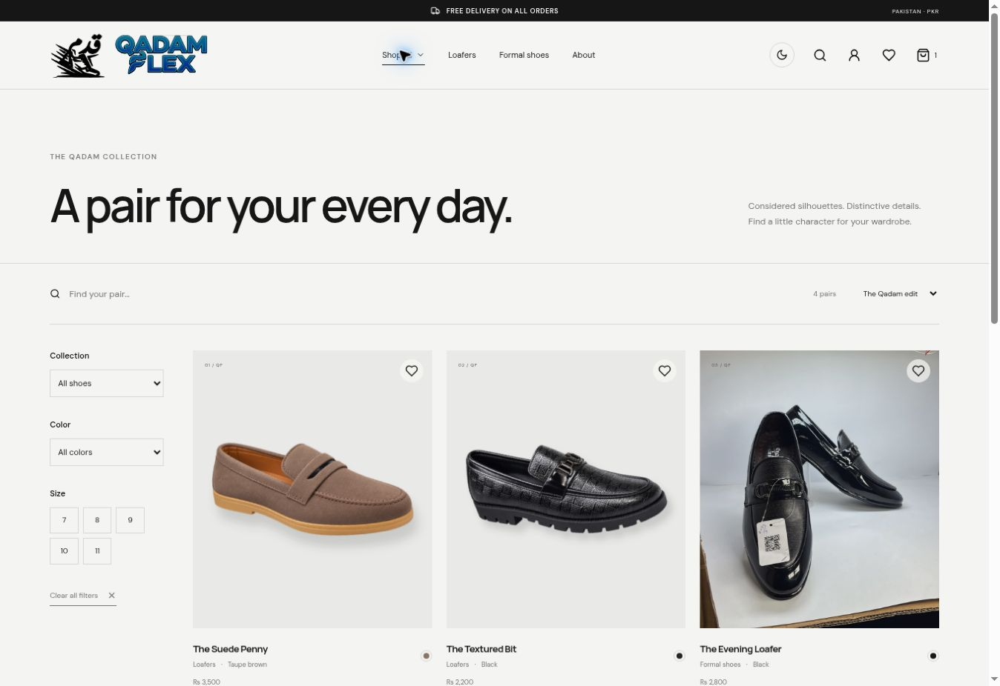

<div align="center">

# QADAM FLEX

**Loafers. Formal shoes. Good form.**

A footwear storefront with an interactive shoe display, customer accounts and a protected store workspace.

[**Visit the store ↗**](https://www.qadamflex.bond/) · [Browse the collection](https://www.qadamflex.bond/shop) · [Customer account](https://www.qadamflex.bond/account)


</div>

[](https://www.qadamflex.bond/)

## The experience

A black-and-chalk storefront built around the store's own shoe photography and approved Qadam Flex identity. Large product imagery, quiet typography, light/dark themes and an interactive shoe display keep the collection at the centre.

| Shopping                                    | Customer account                       | Store management                      |
| ------------------------------------------- | -------------------------------------- | ------------------------------------- |
| Mouse, touch and keyboard shoe interaction  | Private order and payment history      | Product and per-size stock management |
| Search, size/color filters and sorting      | Courier number and tracking link       | Payment receipt review                |
| Product galleries and image enlargement     | Email verification and order updates   | Order statuses and courier tracking   |
| Persistent bag and saved pairs              | Email password reset and recovery code | Sales summary and low-stock alerts    |
| Bank/Easypaisa payment instructions         | Verified-purchase reviews and photos   | Customer review moderation            |
| Free delivery, configured in store settings | Private receipt uploads                | Website support enquiries             |

### Light or dark

The same collection, in two considered themes. The selected preference is remembered between visits.



### A closer look at the collection

Original product photographs, clear prices in PKR and inventory for each available size.



## Orders, from selection to delivery

1. **Choose a pair.** Select the size and quantity, then continue to checkout.
2. **Place the order.** The server checks current prices, delivery and size inventory. Unknown availability remains an enquiry.
3. **Share payment proof.** Bank/Easypaisa customers upload a private receipt; the store verifies payment manually.
4. **Follow delivery.** The owner adds a courier name, tracking number and optional HTTPS link. These appear in the customer's account.
5. **Leave a real review.** Customers with a delivered, eligible order can submit a rating, review and up to two photos. Reviews appear publicly after approval.

Verified account emails receive order, payment and tracking updates. Owner alerts cover new requests, support messages, payment changes and low-stock sizes. Sending uses a durable outbox with provider idempotency and retry handling.

> Courier booking and automatic bank payment verification are not connected. The owner enters courier details and checks payment receipts in the protected dashboard.

## Run locally

Use **Node.js 24 or newer**. Local development uses SQLite; a hosted database is not required.

```bash
git clone https://github.com/Asadlee24/shoes.git
cd shoes
npm ci
npm run admin:setup
npm run dev
```

- Storefront: **http://localhost:3000**
- Administrator: **http://localhost:3000/admin**

The setup command creates private local administrator credentials. Save the password securely and restart the server after changing configuration. Never commit `.env`, the runtime database, receipts or customer data.

```bash
# Production build and local server
npm run build
npm start

# Another development port
npm run dev -- --port 3001
```

## Deploy on Vercel

The live frontend is built with Vite. Vercel Functions run the store API against a dedicated Neon Postgres database. Local SQLite remains a separate development environment.

Configure the following **private Production environment variables** in Vercel, then redeploy:

| Variable                                  | Purpose                                                                               |
| ----------------------------------------- | ------------------------------------------------------------------------------------- |
| `DATABASE_URL`                            | Neon Postgres connection string                                                       |
| `ADMIN_PASSWORD` or `ADMIN_PASSWORD_HASH` | Private administrator authentication; password must be 12–200 characters              |
| `ADMIN_USER`                              | Optional administrator username; defaults to `admin`                                  |
| `RESEND_API_KEY`                          | Transactional email sending                                                           |
| `RESEND_FROM`                             | Optional sender on a verified domain; default is `Qadam Flex <orders@qadamflex.bond>` |

Keep Preview deployments separate from the Production database. Do not prefix secrets with `VITE_` or put them into the client bundle.

On startup, the API creates namespaced tables and applies recorded migrations. Ordinary redeployments preserve saved products, prices, inventory and accounts. Product uploads and private review/receipt bytes persist in Postgres.

## Owner workspace

Open **[/admin](https://www.qadamflex.bond/admin)** and sign in privately.

| Area                   | What the owner can do                                                                               |
| ---------------------- | --------------------------------------------------------------------------------------------------- |
| **Overview**           | See paid order value, average paid order, active/delivered orders and sizes with two pairs or fewer |
| **Collection**         | Manage products, photos, prices, sizes, stock and publication                                       |
| **Orders & enquiries** | Review customer requests, verify receipts, update statuses and add tracking                         |
| **Customer reviews**   | Approve or hide reviews without rewriting the customer's rating or words                            |
| **Store settings**     | Edit delivery, payment details, contacts, discount codes and the private owner notification email   |

**Email handover:** In Store settings → Order notifications, save the owner's receiving email, then use **Send test email**. Customers verify their own account email to receive order updates. Accepted email status means the provider accepted the message; final delivery and bounce information is available in Resend.

**Test records:** Archived requests are excluded from the active order list, customer history and sales totals. The owner-authorized cleanup on 21 October 2026 archives requests at or before its fixed cutoff, returns stock reserved by uncancelled test orders once, and hides their test reviews. New requests remain untouched. Archived history stays private and recoverable through the admin filter.

## Built with

| Layer               | Technology                                                   |
| ------------------- | ------------------------------------------------------------ |
| Interface           | React 19, TypeScript, React Router, Vite                     |
| Product interaction | Three.js, React Three Fiber, GSAP; photographic fallback     |
| Design              | Custom responsive CSS, DM Sans, Manrope, Lucide              |
| API                 | Node.js with server-side validation and transactional writes |
| Persistence         | Neon Postgres in Production; native SQLite locally           |
| Email               | Resend, React Email, database-backed outbox                  |
| Deployment          | GitHub → Vercel                                              |

The interactive display uses original shoe photographs with perspective/flip interaction and an optional Three.js scene. A complete all-angle 3D reconstruction would require a product scan or turntable image set.

## Project map

```text
src/                 Storefront, account and administrator interfaces
server/              Authentication, checkout, payments, reviews and email APIs
api/                 Vercel Function entry points
public/brand/        Approved Qadam Flex logo assets
public/products/     Store-supplied product photographs
docs/images/         Screenshots of the live storefront
tests/               HTTP, Postgres, authentication, inventory and interaction tests
```

## Checks

```bash
npm test
npm run build
npm run smoke
```

Tests use isolated data and fake email delivery. They cover checkout totals and idempotency, inventory reservation/restoration, authentication and CSRF, receipt privacy, review eligibility/moderation, tracking, email links, sales summaries and both database adapters. Interaction tests cover full-turn drag continuity, photo/platform alignment, reduced motion and offscreen frame handling.

---

**Built by [Asad Lee](https://github.com/Asadlee24) for Qadam Flex.** Product photography and brand assets belong to their respective owners; they are not a reusable stock-photo pack. This repository does not grant a license to reuse those assets.
